# Screenshots

All with made-up demo data (`scripts/demo_data.py`): a "Golf", plate "DEMO 123", invented prices and drives.

## Home

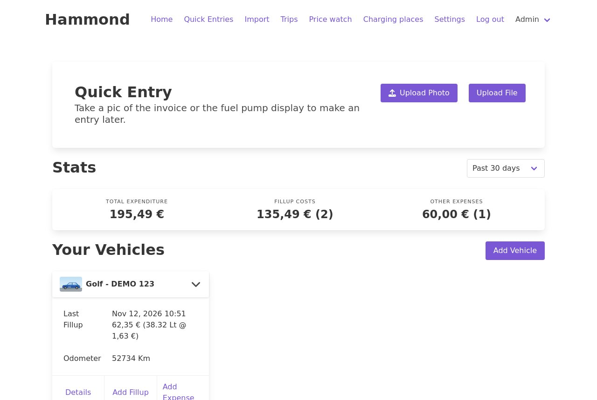

## Vehicle: fill-ups, expenses, stats

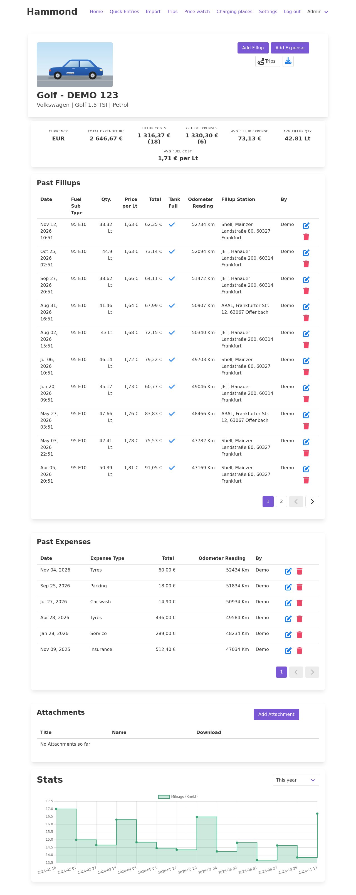

## Edit vehicle: photo, tank, accepted grades, gauge calibration

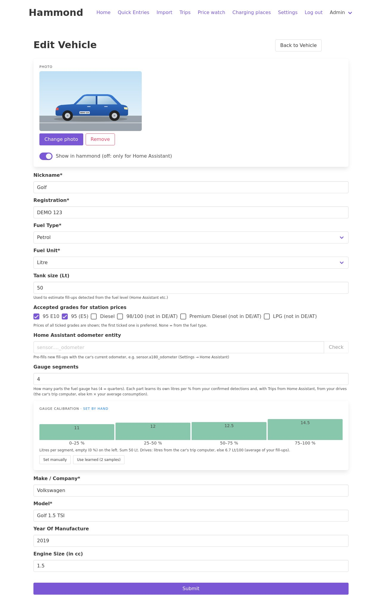

## New fill-up with stations nearby and their prices

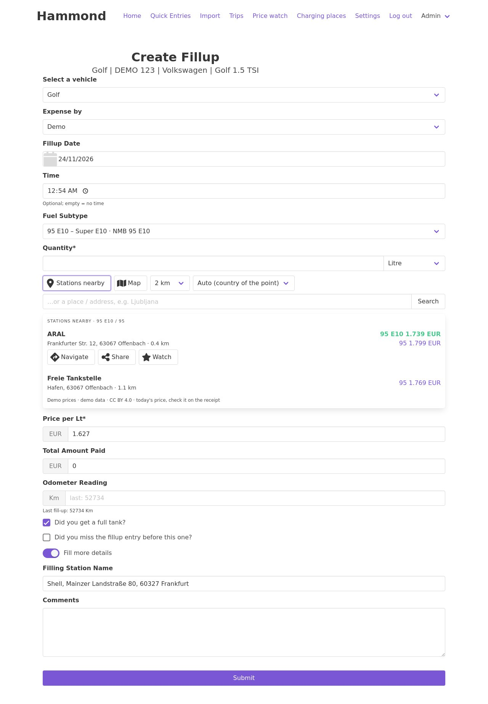

## Trips: routes on a map, addresses, business/private, fuel cost per trip

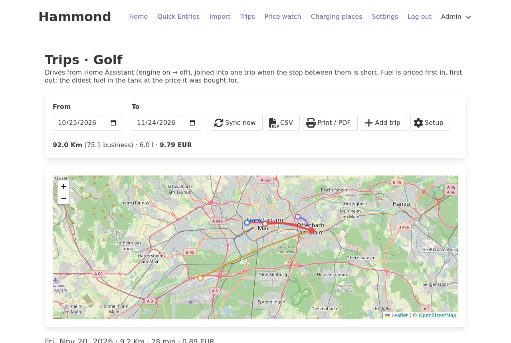

## Price watch: price history, your limit, cheapest hours of the day

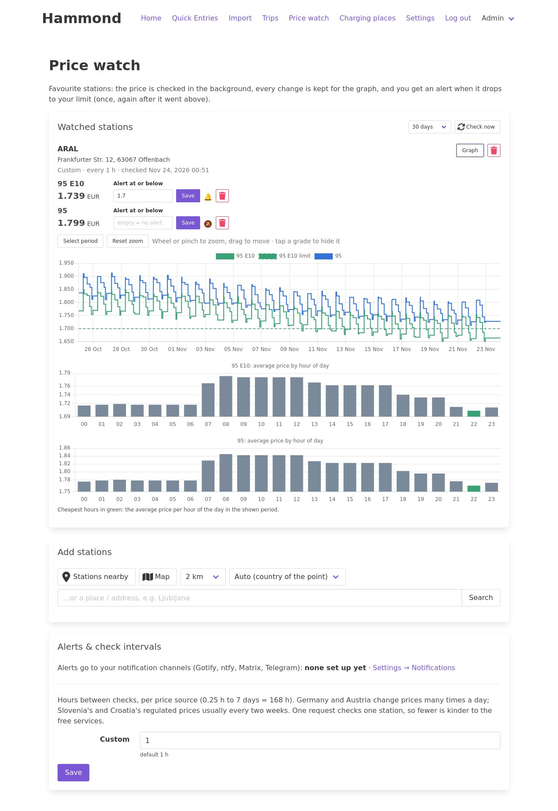

## New expense

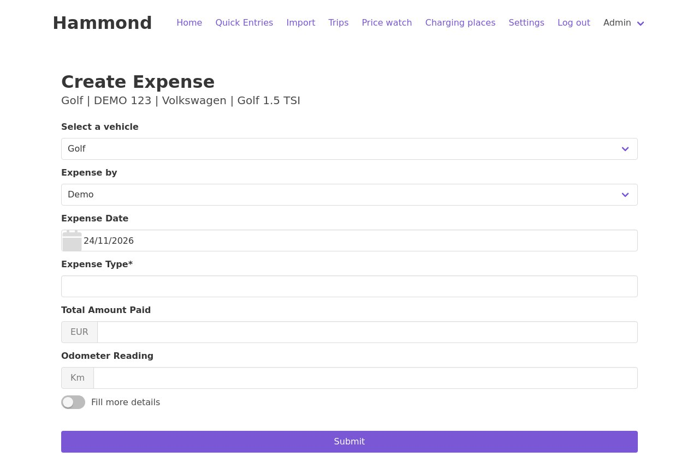

## Settings: notifications, Home Assistant, MQTT, EVCC, API keys

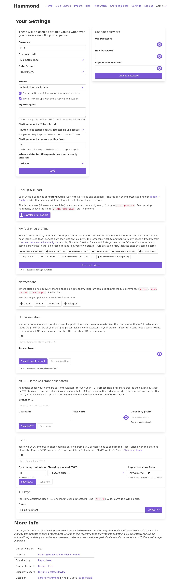

## Admin: site settings and users

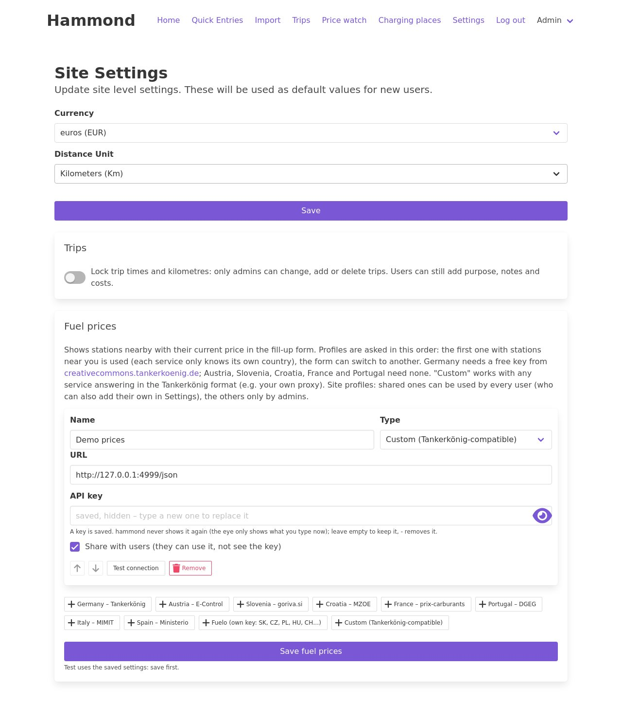

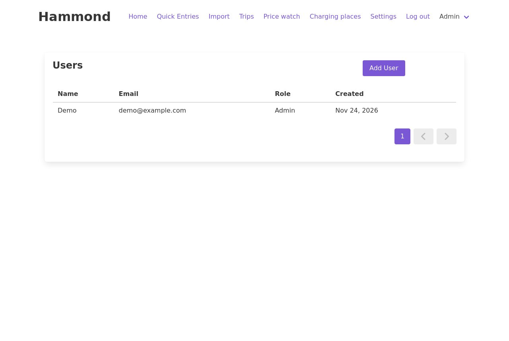

## On a phone

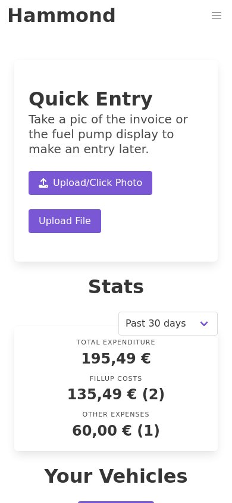 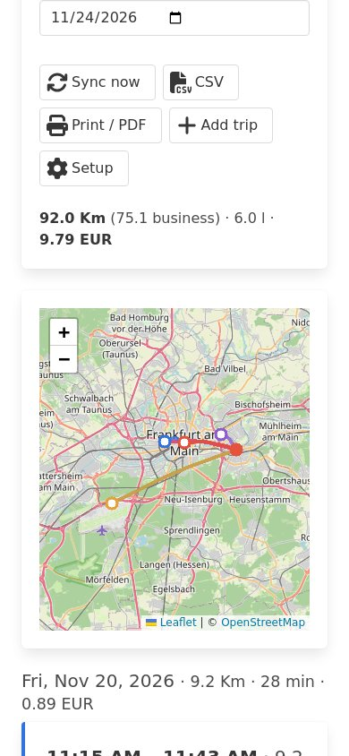
