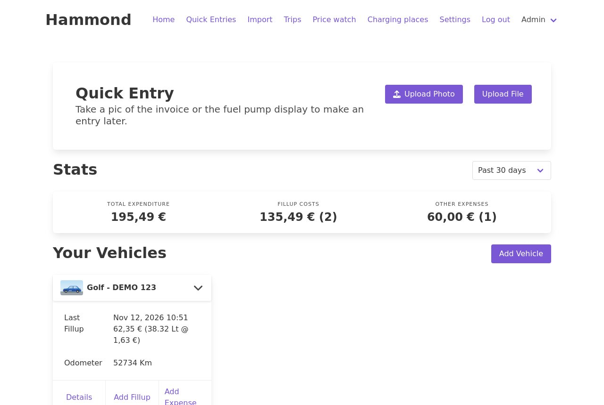

# hammond guides

Step by step, from the first fill-up to Home Assistant and Grafana. Screenshots use made-up demo data
([`scripts/demo_data.py`](../scripts/demo_data.py)); all of them: [Screenshots.md](../Screenshots.md).

| Guide | What you get |
|---|---|
| [Getting started](getting-started.md) | install, first vehicle, fill-ups, expenses, Quick Entry |
| [Fuel prices and Price watch](price-watch.md) | stations nearby with today's prices, watched stations, price history, alerts below your limit |
| [Notifications and chat](notifications.md) | alerts and a fuel chat bot on Gotify, ntfy, Telegram or Matrix |
| [API keys](api-keys.md) | the read/detection API for scripts, Home Assistant, Node-RED |
| [Home Assistant](home-assistant.md) | odometer pre-fill, detected fill-ups, sensors over MQTT, an example dashboard |
| [Trips](trips.md) | a trip log from Home Assistant: routes, addresses, business/private, fuel cost per trip |
| [Tank and gauge calibration](gauge.md) | litres from the fuel gauge, learned or set by hand |
| [Electric and EVCC](electric.md) | charging places with tariffs, imports from EVCC |
| [Grafana](../integrations/grafana/README.md) | long-term statistics from Home Assistant's history |

