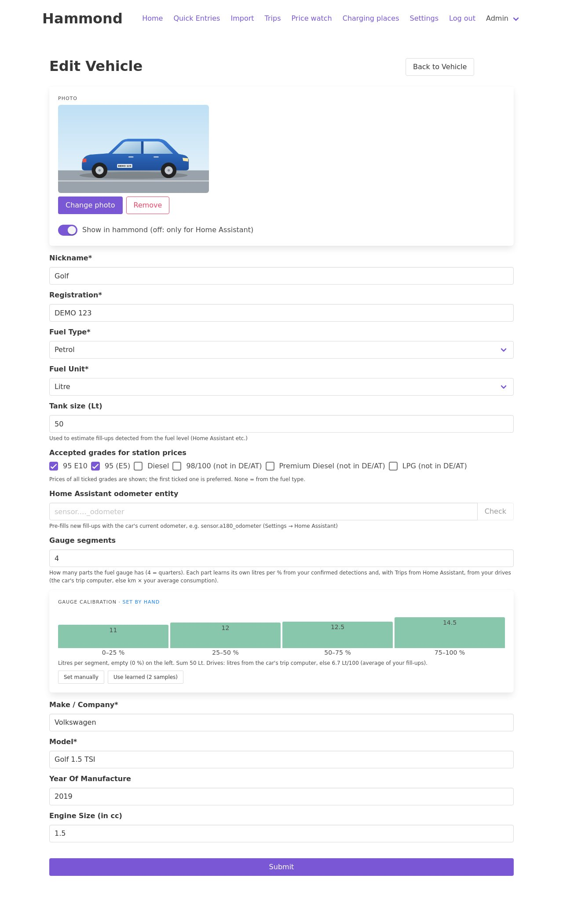

# Tank and gauge calibration

A fill-up detected from the fuel level needs litres: hammond estimates them from the level difference. Fuel gauges
are rarely linear: many read "full" for a long time, so the top quarter holds more litres than the others.

*Edit vehicle* → **Gauge calibration**: the tank in parts (4 = quarters; *Gauge segments* changes it), litres per
part as bars.

## Learned

hammond learns the litres per part by itself:

- from **confirmed detections** (the level went 62 → 100 %, you filled 19.5 l), and
- from your **drives** ([Trips](trips.md)): the gauge went 62 → 57 % on drives that used 4.1 l, with the litres from
  the car's trip computer (or kilometres × your average consumption from full-tank fill-ups). Every drive teaches
  the part of the tank you're driving through, also the low ones you rarely fill up from.

Until there are two samples it's linear (tank size / 100 per %). **Reset** starts learning again (e.g. after a gauge
repair). Once learned, the tank size is suggested from the sum.

## By hand

**Set manually**: litres per part, empty tank on the left, the sum below. It's used at once and wins over the
learned values (still counted, to compare); **Use learned** switches back. Changing the number of parts makes a
manual setting inactive.
