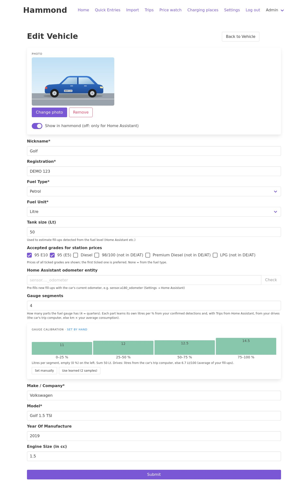
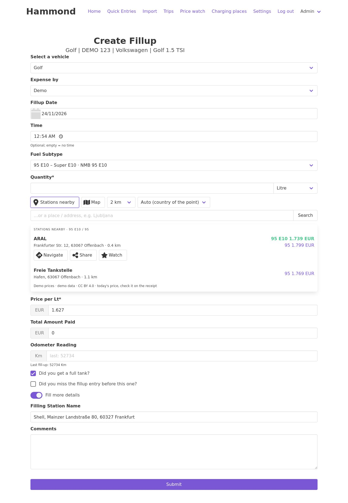
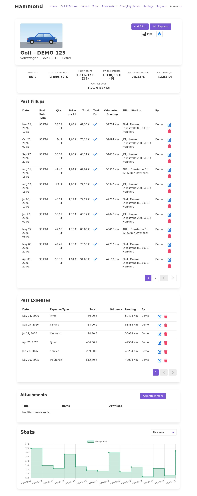

# Getting started

## Install

Docker is easiest (see the main [README](../README.md#installation)):

```bash
docker run -d -p 3000:3000 --name=hammond -v "/host/path/to/assets:/assets" -v "/host/path/to/config:/config" ghcr.io/nenchi/hammond:latest
```

Open `http://<host>:3000`: the first page creates the admin account (name, e-mail, password, currency, km or
miles). More users: *Admin → Users*.

## Your car

*Home → Add Vehicle*: nickname, plate, fuel type, unit. Then *Edit* on the vehicle for the extras:

- **Photo**: *Take or choose a photo* (on a phone: the camera or the gallery). It's shrunk before upload.
  *Show in hammond* off keeps it only for Home Assistant.
- **Tank size**: needed for fill-ups detected from the fuel level.
- **Accepted grades** (95 E10, 95, Diesel…): which prices the station lists show, the first ticked one preferred.



## Fill-ups and expenses

- *Add Fillup*: date and time, quantity, price, odometer, full tank. **Stations nearby** lists the stations
  around you with today's price of your grades; tapping one fills in the station and the price
  (see [Fuel prices](price-watch.md)). The odometer warning catches typos (a fill-up 10× further than usual).
- *Add Expense*: service, tyres, insurance, parking…
- **Quick Entry** (home page): take a photo of the receipt or the pump now, turn it into a fill-up later.



## Statistics

The vehicle page lists fill-ups and expenses with totals and a consumption chart. The home page and the vehicle
page have periods from *This week* to *All time*, and **Custom…** with your own dates.



Next: [Fuel prices](price-watch.md) · [Home Assistant](home-assistant.md) · [Notifications](notifications.md)
