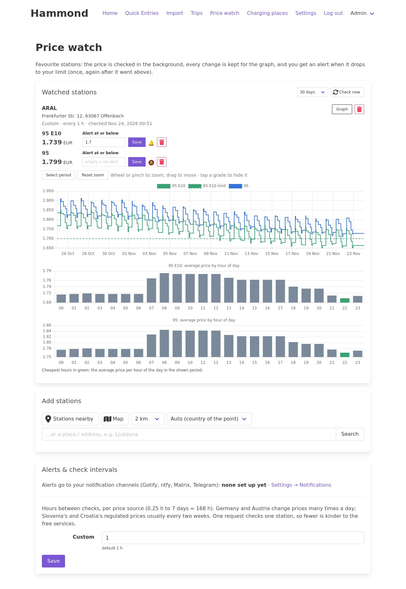

# Fuel prices and Price watch

## Where the prices come from

*Admin → Site settings → Fuel prices* (for everybody) or *Settings → My fuel price profiles* (only for you).
**Auto (country of the point)** picks the right source for where you are.

| Country | Source | Key |
|---|---|---|
| Germany | Tankerkönig (MTS-K) | free key: [creativecommons.tankerkoenig.de](https://creativecommons.tankerkoenig.de) |
| Austria | E-Control (5 cheapest stations show a price) | built in |
| Slovenia | goriva.si | built in |
| Croatia | MZOE | built in |
| France | prix-carburants.gouv.fr | built in |
| Portugal | DGEG | built in |
| Italy | MIMIT (prices of 8:00 today) | built in |
| Spain | Ministerio (every 30 min) | built in |
| many (BG, RO, …) | Fuelo.net | key; station prices need Fuelo Pro |
| anything else | *Custom*: a Tankerkönig-compatible URL | yours |

Settings has the search radius (2–25 km). **Test** on a profile checks it right away.

## Stations nearby

In a new fill-up: **Stations nearby** (your device's location), **Map** (tap a point), or a place/address. Each
station shows the prices of your accepted grades; **Navigate**, **Share**, **Watch**. A fill-up detected by Home
Assistant with the phone's position takes the station you're standing at and its price on its own.

## Watched stations

**Watch** a station (any grade) and hammond checks it in the background: *Price watch* menu.

- **Graph**: the price history of all watched grades of the station, 7 days to a year or **Custom…** dates;
  zoom with the wheel or a pinch; your fill-ups there as dots.
- **Average price by hour of day**: when it's cheapest (green).
- **Alert at or below**: a price limit per grade. You get one alert when it reaches the limit (again only after
  it went above), on your [notification channels](notifications.md); tapping it opens the navigation.
- **Check intervals** per source: Germany and Austria change prices many times a day (1 h is fine), Slovenia's
  and Croatia's regulated prices every two weeks. Fewer checks are kinder to the free services.
- **How long prices are kept:** forever. Only changes are stored (a few thousand a year per grade, a few hundred
  KB). Deleting a watch or changing its grade deletes its history.

Prices are in Home Assistant too ([MQTT](home-assistant.md#sensors-over-mqtt)) and in the API
(`GET /api/v1/me/priceWatches/{id}/history?from=2026-01-01&to=2026-03-31`).
