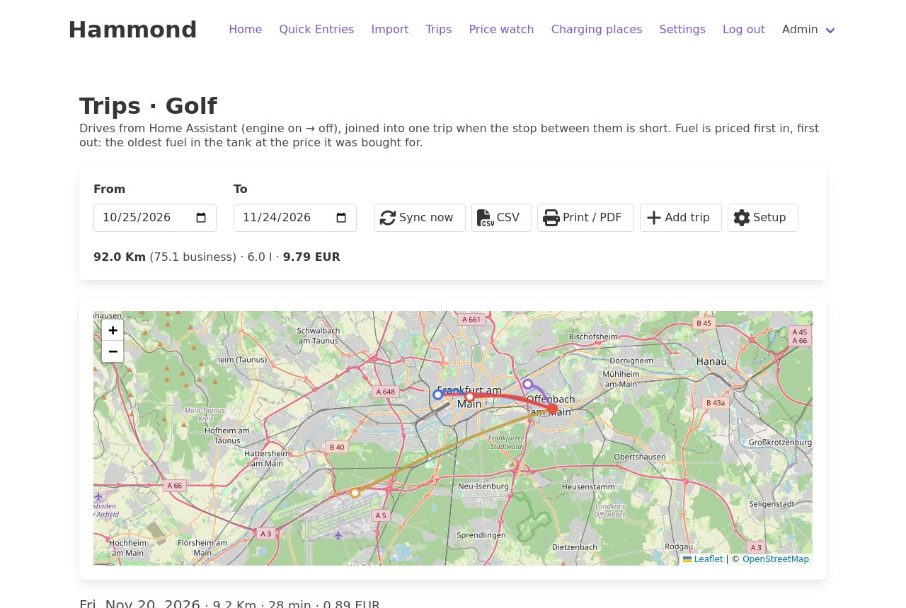
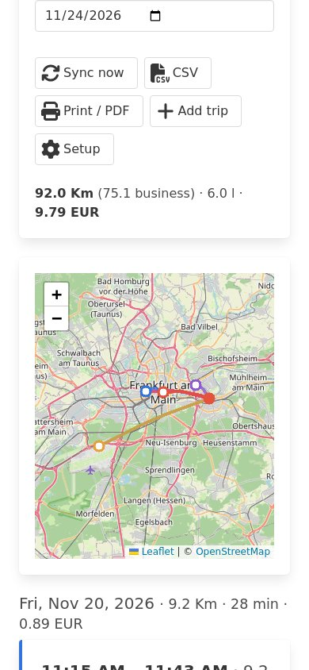

# Trips

A trip log from Home Assistant's history: every drive (engine on → off) with time, kilometres, fuel and cost, start
and end address and the route on a map. Drives with a short stop between them (15 minutes by default, e.g. a fuel
stop) are one trip.

## Set up

*Trips* (menu; with several cars, pick one at the top) → **Setup**:

- **Ignition** (required) and, optionally, **fuel level** and the trip computer's **distance** and **consumption
  since start**. With a Mercedes (Mercedes me integration) **Suggest from odometer entity** fills them in.
- **Car location** (the car's own `device_tracker`, if its integration has one) and **Phone location** (the HA
  companion app on the driver's phone, used when the car has none). Tap the field to pick one of your trackers.
  These give each drive its **route** and **addresses** (OpenStreetMap). A phone whose positions don't fit the
  kilometres driven (left at home, someone else drove) gives none.

hammond reads new drives every 10 minutes (**Sync now** for at once; the first sync reads the last 10 days).

## On and off

- **Record drives automatically** (Trips → Setup, per car, for everyone using it): off pauses reading drives from
  Home Assistant, e.g. on holiday or when someone else drives. Sensors and trips stay; trips by hand still work.
  Back on, recording starts from that moment (the paused days aren't filled in). When an admin has locked trips,
  only an admin can pause.
- **Show Trips** (Settings, per user): off hides Trips for you: the menu entry and buttons, the trip sensors in
  Home Assistant and the trip chat commands (`cost` then always saves a plain expense). The car keeps recording for
  other users.

## Use

- Per trip: **business/private**, purpose, notes, costs (toll, vignette, parking…), **map** to zoom to it. Join or
  split trips by hand.
- **Fuel cost, first in, first out:** a trip burns the oldest fuel in the tank at the price it was bought for.
- **CSV** and **Print / PDF** for any period, with from/to addresses.
- *Admin → Site settings*: **lock** times and kilometres so only admins change them (a tax log); users still add
  purpose, notes and costs.
- In chat: `trips`, `purpose Customer Müller`, `business`, `cost toll 12.50 A3`.

